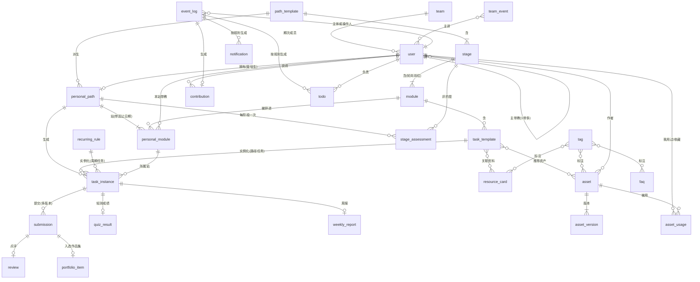
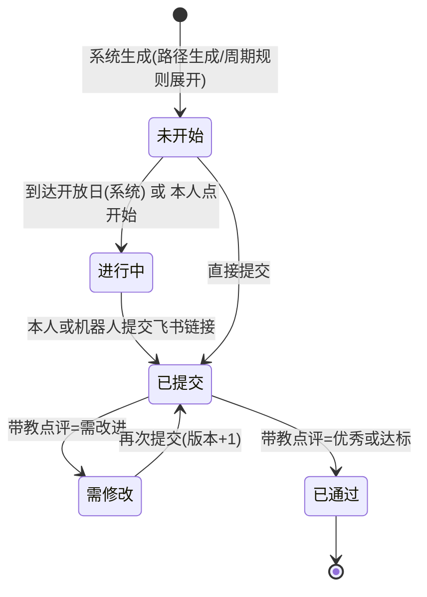
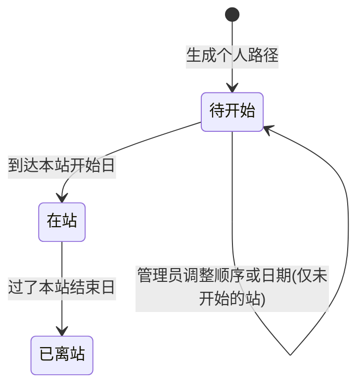
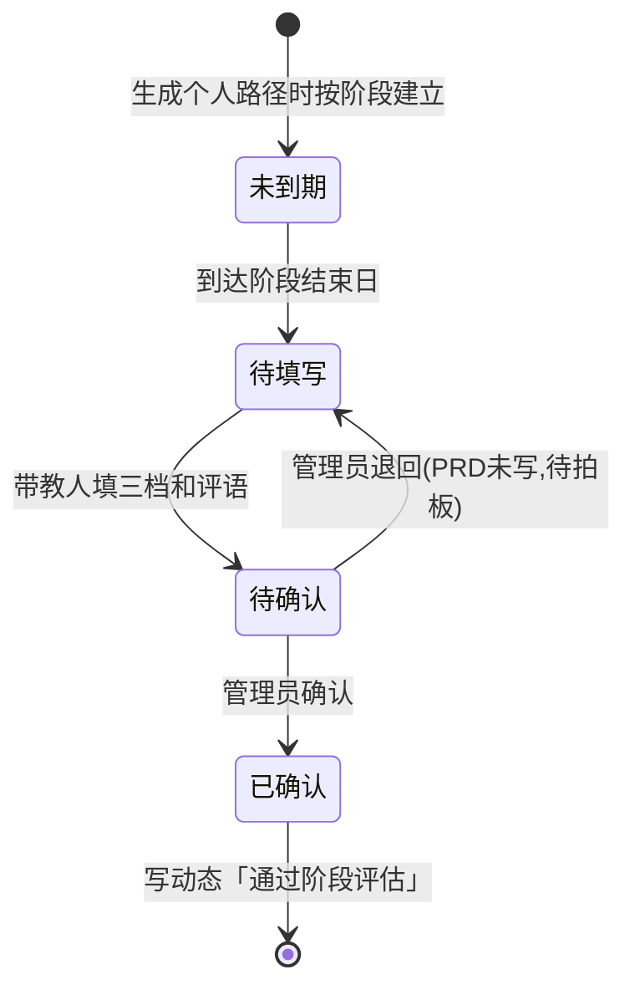
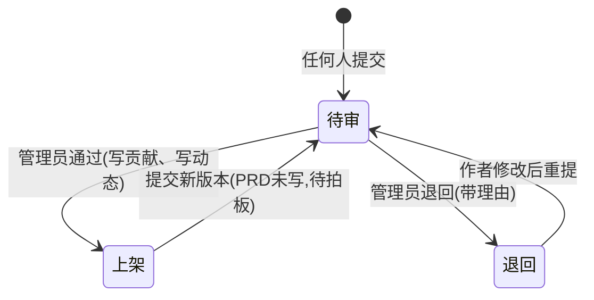

# 管培生工作台 · 数据本体梳理（对象、关系、状态、事件、时间）

- 方法：AI 落地三步法第二步的数据本体方法（对象 → 关系 → 状态 → 事件 → 规则 → 待办 → 呈现 → 写回），外加「时间模型」一层。
- 材料：`docs/PRD.md`（v1.0，235 行）、`web/src/main.tsx`、`web/src/data/types.ts`、`web/src/data/mock.ts`、`web/src/data/api.ts`、`web/src/pages/*.tsx`、`web/src/components/Layout.tsx`、GitHub issue #5 #6 #15 #17。
- 依据标注：**PRD L行号** = PRD 原文；**原型 文件:行** = 原型现状；**推导** = 由前两者推出，写推导链。示例数据里的人名、日期只用来说明结构，不当业务事实。
- 本文只读仓库，没有改任何文件。

---

## 0. 结论先行

1. **PRD 第 3 节是按「板块」列页面的，但大半页面其实是同一份数据的不同投影。** 动态流、通知、待办、个人档案时间线、贡献记录、日历，都是「事件」和「带时间的对象」按人、按角色、按时间切出来的视图。板块清单里看不出这一点，所以日历这类跨板块视图容易漏。
2. **工作台里带时间的东西有 5 种形状**：时段（站、阶段、培养期、任务开放期、活动）、截止（任务、周报、轻测、阶段评估、点评）、时刻（换站、入职、答辩、公告发布）、周期（周期任务规则）、外部日程（飞书日历里的活动、带教 1:1）。把它们统一成「日程项」后，四个时间视图是推出来的，不用另想：管培生的「我的本周」、带教人的「多人周视图」、管理员的「轮岗排期甘特」、全员的「团队活动月历」。
3. **轮岗日历在 PRD 里两处出现（L39 页面表、L66「由个人路径汇总生成」），但第 12 节分期表三期都没列它**（L172–174 只写了「成长路径（模板、个人路径、任务、提交、点评、带教看板）」）。原型没做，原因是它掉在分期的缝里，不是原型漏做。通知中心同样没进任何一期。
4. **本体缺 6 个对象**：周期任务规则、日程项、事件（事件日志）、待办、通知、站带教关系（主带教 vs 每站带教）。PRD 第 9 节把动态流（activity_feed）列成实体，但它其实是事件日志的公开投影。
5. **任务其实是时段，不只是截止。** 任务模板有「天数」（原型 types.ts:31 `days`），任务实例只存了截止（types.ts:51 `dueAt`）。补上「开放日 = 截止 − 天数」，「未开始 → 进行中」就能按时间自动流转，任务也能上甘特。
6. **轻测、周报、阶段评估各有自己的状态机，不能套任务的「提交飞书链接 → 点评」**。原型把轻测、周报做成普通周期任务（mock.ts:114–115，轻测的产出形式写成「文档」），和 PRD 的 `quiz_result`、`weekly_report`（L135–136，由机器人写入）对不上。
7. **「带教人」在 PRD 里是两种关系**：管培生的主带教（L109、L129）和每个模块（站）的带教人（L65、L131）。原型把每站带教都填成主带教（mock.ts:70–80），任务的带教人也取主带教（mock.ts:95）。这决定了「谁能看点评」「带教人多人视图里有谁」「岗位承载量怎么算」，需要常浩拍板。
8. **和飞书日历的关系推荐分三种处理**：活动读飞书（PRD L111 已定）；截止、换站这类由路径推算出来的东西工作台自己算、自己展示，提醒交给机器人推送，不写进飞书日历；带教 1:1、跟岗这类个人日程一期不进工作台，二期再决定要不要读带教人的日历。
9. **信息架构建议**：一级导航保留 6 个板块不动；在顶栏和「搜索、通知」并列加两个跨板块入口「日程」和「待办」。日程页按角色切四种视角，成长里的「轮岗日历」、团队里的「活动」、首页的「本周」都是同一份日程项的切片，深链到日程页。「答辩材料包」从「成长 · 考核」挪到「个人档案」。
10. **待拍板 12 项**集中在第 9 节，每项带推荐答案。

---

## 1. 对象清单

写入方：**工作台**（网页上的人工操作）、**系统**（工作台按规则自动生成或推算）、**机器人**（带教机器人经接口写入，PRD L148–160）、**飞书**（从飞书同步或读取）、**管理员**（后台人工维护）。
可见性：**公开**（所有登录的飞书成员）、**受限**（本人 + 带教人 + 管理员，PRD L85）、**管理员**、**本人 + 管理员**、**参与人**（以飞书权限为准）。

### 1.1 人与组织

| 对象 | 关键字段 | 写入方 | 可见性 | 依据 |
|---|---|---|---|---|
| 团队/期次 `team` | 名称、期次、开始日期 | 管理员 | 公开 | PRD L14、L128。原型只有字符串 `team: '2026 秋季班'`（mock.ts:13），没有实体 |
| 用户 `user` | 飞书 open_id、姓名、头像、角色、团队、入职日期、**主带教人**、自我介绍、擅长领域 | 飞书（身份）、管理员（角色、带教）、本人（介绍） | 基本信息公开 | PRD L28、L109、L129；原型 types.ts:6–18 |
| 角色分配 | 用户、角色、分配人、时间 | 管理员 | 管理员 | PRD L28「新登录默认同事」。**推导**：新登录是一个事件，要有人把他改成管培生或带教人，否则他看不到自己的路径 → 需要「待分配角色」待办 |

### 1.2 路径与时间

| 对象 | 关键字段 | 写入方 | 可见性 | 依据 |
|---|---|---|---|---|
| 路径模板 `path_template` / 阶段 `stage` / 模块 `module` / 任务模板 `task_template` | 层级、顺序、阶段天数、模块所属业务线、任务要求、产出形式、**任务天数**、关联资料、推荐资产 | 管理员 | 公开 | PRD L64–65、L70、L130；原型 types.ts:22–34（`Stage.days`、`TaskTemplate.days` 已有） |
| 个人路径 `personal_path` | 用户、模板、起止日期、状态 | 管理员生成，系统推算 | 进度状态公开 | PRD L65、L131 |
| 个人模块（站） `personal_module` | 个人路径、模块、顺序、起止日期、**本站带教人** | 管理员 | 时段与进度公开 | PRD L65「每个模块的带教人」、L131；原型 types.ts:36 |
| **周期任务规则**（新增） | 名称（日报、周报、月度物料、轻测）、频率（每日 / 每周几 / 每月最后一天 / 指定日期）、截止时刻、适用阶段或期次、完成方式（提交链接 / 机器人写周报 / 机器人写成绩） | 管理员 | 公开 | **推导**：PRD L71 说周期任务「贯穿整个培养期」，issue #6 验收写「按日、按周、按月最后一天、按指定日期生成」→ 生成实例必须有一份规则，PRD 第 9 节（L126–146）和原型 types.ts 都没有这个对象 |
| 任务实例 `task_instance` | 个人路径、来源（任务模板 / 周期规则）、类型（路径/周期）、所属站、**开放日**、截止、负责带教人、状态、逾期标记、完成度 | 系统生成；状态由工作台和机器人推动 | 名称与状态公开，详情受限 | PRD L70–73、L132；原型 types.ts:42–55（**没有开放日**） |

### 1.3 产出与考核（全部受限）

| 对象 | 关键字段 | 写入方 | 可见性 | 依据 |
|---|---|---|---|---|
| 提交 `submission` | 任务、飞书链接、提交时间、版本号、提交渠道（网页/机器人） | 工作台（本人）、机器人 | 受限 | PRD L72、L133、L155 |
| 点评 `review` | 提交、带教人、三档评价、评语、时间 | 工作台（带教人、管理员） | 受限 | PRD L74、L134；原型 api.ts:165–174 允许管理员点评 |
| 轻测成绩 `quiz_result` | 用户、对应的轻测任务实例、成绩、出题时间、作答时间 | 机器人 | 受限 | PRD L78、L135、L155 |
| 阶段评估 `stage_assessment` | 用户、阶段、填写带教人、三档、评语、确认人、确认时间、状态 | 工作台（带教人填，管理员确认） | 受限 | PRD L79、L135 |
| 周报 `weekly_report` | 用户、周次、正文或链接、提交时间、**对应的周期任务实例** | 机器人 | 正文受限，是否已交公开 | PRD L112、L136 |
| 答辩材料包 | 不是存储对象，是对个人档案的一次汇总导出 | 系统 | 受限 | PRD L80「从个人档案一键汇总」 |
| 作品集 `portfolio_item` | 关联提交、提名人、本人同意标记、状态 | 工作台 | 同意后公开 | PRD L86、L145；**提名人 PRD 没写**，见第 9 节 |

### 1.4 内容

| 对象 | 关键字段 | 写入方 | 可见性 | 依据 |
|---|---|---|---|---|
| 资料卡片 `resource_card` | 飞书 token、标题、摘要、标签、关联阶段或任务、同步时间、标注状态 | 飞书（目录同步）+ 管理员（补标签、挂任务） | 公开（正文权限飞书管） | PRD L90、L137 |
| 标签 `tag` | 维度（阶段模块 / 主题 / 类型 / 岗位）、值 | 管理员 | 公开 | PRD L91–96、L144；阶段模块维度直接引用路径结构 |
| FAQ `faq` | 问题、答案、来源、标签 | 机器人 | 公开 | PRD L97、L138 |
| AI 资产 `asset` / `asset_version` | 类型、标题、说明、标签、使用方法、示例、SKILL.md、作者、版本、状态、退回理由、关联任务模板 | 工作台（任何人提交，管理员审核） | 上架后公开 | PRD L101–104、L139 |
| 使用 / 收藏 `asset_usage` / `favorite` | 用户、资产、时间 | 工作台 | 计数公开 | PRD L104、L140 |
| 公告 `announcement` | 标题、正文、发布时间、已读 | 管理员 | 公开 | PRD L110 |
| 活动 `event`（团队活动） | 飞书日历事件 id、类型（分享会/路演/读书会）、主讲人、时间、地点、妙记回放链接 | 飞书（日程）+ 管理员（挂回放、认定主讲） | 公开 | PRD L111、L143；原型只有一条写死的 `nextEvent`（mock.ts:186），types.ts 没有活动类型 |

### 1.5 贡献与激励

| 对象 | 关键字段 | 写入方 | 可见性 | 依据 |
|---|---|---|---|---|
| 贡献 `contribution` | 用户、行为类型、关联对象、时间、加权 | 系统（由事件生成）、管理员（加权） | 公开 | PRD L104、L117、L120、L141；原型类型已定义但没有使用（types.ts:85），贡献是现算的（api.ts:252–258） |
| 积分流水 / 兑换 / 徽章 | 用户、分值、来源；兑换物、状态 | 系统、管理员 | 本人 + 管理员 | PRD L118–119、L142 |

### 1.6 运行层（本体动起来需要的对象，PRD 没列）

| 对象 | 关键字段 | 写入方 | 可见性 | 推导 |
|---|---|---|---|---|
| **事件** `event_log` | 事件类型、主体对象、发生时间、来源（网页/机器人/飞书/系统推算）、操作人、可见级别、去重键；只追加 | 系统 | 按事件类型的可见级别 | PRD L110 动态流「自动生成」、L56 档案「成长时间线」、L104 审核通过「写入贡献」、L120「按历史补算」→ 这些都需要一份按时间追加、带可见级别的事件记录。`activity_feed`（L143）只是它的公开子集 |
| **日程项** `schedule_item` | 类型、形状（时段/截止/时刻）、开始、结束、所属人、关联对象、来源、可见级别 | 系统推算为主（多数不落库，查询时生成），飞书活动落库 | 按类型 | 第 5 节 |
| **待办** `todo` | 负责人、事件类型、规则、关联对象、出现时间、期限、状态（待处理/已完成/已撤销） | 系统按规则生成，动作完成时系统关闭 | 只给负责人（管理员可看全部） | 方法论「待办 = 事件 × 规则」。原型的待点评（api.ts:176）、审核队列、逾期都是现算的列表，没有统一对象，也没有「谁的、多久算晚」 |
| **通知** `notification` | 接收人、事件、渠道（站内 / 机器人飞书推送）、已读 | 系统 | 只给接收人 | PRD L33 顶栏有通知、L37 通知中心，但没写「什么事件通知谁」 |
| 机器人客户端 `bot_client` | 密钥、权限范围、最近调用时间 | 管理员 | 管理员 | PRD L146、L152；issue #17 |

---

## 2. 关系图



几处需要说清的关系：

| 关系 | 基数 | 说明 | 依据 |
|---|---|---|---|
| 管培生 — 主带教 | 多对一 | 档案上的「带教人」 | PRD L109、L129；原型 types.ts:13 |
| 个人模块 — 本站带教 | 多对一 | 每站可以不同人。轮岗六站分属老师线、客户线、市场（原型 mock.ts:35–40），按常理各线带教不是同一人，但这是推测，要常浩确认 | PRD L65、L131；原型 mock.ts:70–80 全部填了主带教 |
| 任务实例 — 负责带教 | 多对一 | **推导**：路径任务的带教应取所属站的带教（PRD L70 任务字段有「带教人」，L65 带教人挂在模块上）；周期任务取主带教。原型统一取主带教（mock.ts:95） | 推导 |
| 阶段评估 — 填写人 | 一对一 | 轮岗阶段跨六站、可能有六位带教，PRD L79 只说「带教人填写」，没说哪位 | 待拍板 |
| 周报、轻测 — 任务实例 | 一对一 | **推导**：PRD L71 把周报、轻测列为周期任务，又在 L135–136 单列实体。合理的结构是「周期任务实例是待办的壳，周报 / 轻测成绩是它的完成凭证」，这样逾期、按时率一套口径就能覆盖 | 推导 |
| 事件 — 动态 / 通知 / 待办 / 贡献 / 时间线 | 一对多 | 一个事件按规则投影成多种东西，见第 4 节 | 推导 |
| 资料、资产、作品集 — 标签 | 多对多 | 四个维度共用，「阶段/模块」维度直接引用路径结构 | PRD L91–96 |

---

## 3. 状态机

### 3.1 任务实例（路径任务；周期任务里「提交链接」类的日报、月度物料也用这一套）



| 流转 | 触发 | 负责人 | 写入 | 依据 |
|---|---|---|---|---|
| 生成 → 未开始 | 管理员生成个人路径；周期规则展开 | 系统 | task_instance | PRD L65、L71；issue #5、#6 |
| 未开始 → 进行中 | **PRD 没写触发条件**。推荐：到达开放日自动流转（开放日 = 截止 − 模板天数） | 系统 | task_instance.状态 | PRD L73 只列了状态；原型没有任何动作写 `doing`，状态是示例数据里写死的（mock.ts:112）；推导见第 0 节第 5 条 |
| → 已提交 | 提交飞书链接 | 管培生（网页）/ 机器人 | submission 新增一版；task_instance.状态 | PRD L72、L155；原型 api.ts:157–164 |
| 已提交 → 需修改 / 已通过 | 带教写点评 | 本任务带教人或管理员 | review；task_instance.状态 | PRD L73–74；原型 api.ts:165–174 |
| 需修改 → 已提交 | 再次提交 | 管培生 | submission 版本+1 | PRD L133「版本」 |
| **逾期**（标记，不是状态） | 状态为未开始/进行中/需修改，且当前时间晚于截止 | 系统 | 查询时计算 | PRD L73「自动标逾期」；原型 api.ts:119–120 |
| **迟交**（标记） | 首次提交时间晚于截止 | 系统 | 查询时计算 | **推导**：主指标「按时提交率」（PRD L178）要区分按时和迟交；原型 api.ts:200–207 已按这个口径算 |

待拍板：「需修改」有没有新的截止时间？没有的话，打回的任务一律算逾期（截止早过了），带教人的「需要跟进」会被它淹没。推荐：点评为「需改进」时给一个修改期限，**天数是建议值，由常浩定**。

### 3.2 轻测（周期任务，完成凭证是成绩）

`未开始 → 已出题（机器人推送题目） → 已出分（机器人写回成绩） / 过期未答`

- 依据：PRD L78「机器人出题，成绩写回」、L155。原型把轻测当成要交「文档」的普通任务（mock.ts:114），和成绩写回对不上。
- 没有「需修改 / 已通过」，也不需要带教点评。

### 3.3 周报

`未交 →（机器人收到）已交`；截止过了仍未交 = 逾期未交。

- 依据：PRD L112「机器人收周报」「只显示谁交了、谁没交」、L136。
- 周报要不要带教点评，PRD 没写；按 L112「只显示谁交了」推断不点评。原型里周报有「已通过」状态（mock.ts:117），意味着被点评过，和 PRD 不一致。

### 3.4 个人模块（站）与个人路径



- 原型按时间计算（api.ts:81–89），只有时间位置，没有完成度。
- **推导**：「进度状态（走到哪一步）对团队公开」（PRD L84）问的是时间位置；带教看板、答辩材料包还要「这一站的任务通过了几个」。建议拆两个字段：**时间位置**（待开始/在站/已离站，系统推算）和**完成度**（本站任务已通过数/总数，系统推算）。「离站时还有未通过的任务」是一个值得生成待办的事件（第 4 节 E06）。
- 个人路径：`待分配 → 进行中 → 已结束（定岗答辩完成）`；新管培生进来后还没生成路径，就是「待分配」，应成为管理员待办。
- 调整：原型「已开始或结束的站不能再调」（Admin.tsx:145 一带的说明文字）；但调整后**未开始的任务截止没有重算**（api.ts:106「只改路径，不重排历史任务」），issue #5 验收要求「任务截止时间按日期推算」。路径调整必须是一个事件，触发未来任务重排。

### 3.5 阶段评估



- 依据：PRD L79、L110「通过阶段评估」进动态流（动态流里只出现「通过」，不出现三档结果，符合 L110「不出现考核结果」）。
- 原型没有这个对象，但示例动态里已经出现「通过了『通识』阶段评估」（mock.ts:176）。

### 3.6 AI 资产



- 依据：PRD L104、L139；原型 types.ts:62、api.ts:242–250。
- 上架后改版要不要重新审核、能不能下架，PRD 没写。

### 3.7 其他有流转的对象

| 对象 | 状态 | 触发 | 依据 |
|---|---|---|---|
| 作品集 | 候选 → 待本人同意 → 已公开 / 本人拒绝；已公开 → 撤回 | 谁提名 PRD 没写；同意由本人 | PRD L86、L145 |
| 资料卡片 | 新同步（未标注）→ 已标注 → 失效（飞书侧删除或移走） | 同步任务；管理员补标签 | PRD L90 |
| 团队活动 | 预告 → 进行中 → 已结束待挂回放 → 已挂回放 | 飞书日程时间；管理员挂妙记链接 | PRD L111 |
| 兑换申请 | 已申请 → 已发放 / 已驳回 | 管理员线下处理 | PRD L118 |
| 用户角色 | 同事（默认）→ 管培生 / 带教人 / 管理员 | 管理员分配 | PRD L28 |
| 机器人密钥 | 有效 → 已吊销 | 管理员 | PRD L152；issue #17 |
| 多维表格迁移 | 过渡中 → 只读归档 | 到截止日期 | PRD L156–159；原型 mock.ts:205 |

---

## 4. 事件清单

时间属性：**时刻**（某一刻发生）、**时段**（有起止）、**截止**（某刻之前要完成）、**周期**（按规则重复）。
来源：**推算**（由个人路径或周期规则按时间算出，不需要人操作）、**网页**、**机器人**、**飞书**（同步或读日历）、**手工**（管理员）。
「生成的待办」里的期限都是**建议值**，由常浩定。

| # | 事件 | 时间属性 | 来源 | 生成的待办（负责人 · 期限） | 通知谁 | 进动态？ | 依据 |
|---|---|---|---|---|---|---|---|
| E01 | 新成员首次登录 | 时刻 | 飞书登录 | 管理员 · 分配角色 | 管理员 | 否 | PRD L28；推导 |
| E02 | 个人路径生成 | 时刻 | 手工 | 无；生成任务实例、阶段评估占位 | 本人、各站带教 | 否 | PRD L65；issue #5 |
| E03 | 个人路径调整（顺序或日期） | 时刻 | 手工 | 系统重排未开始任务的截止 | 本人、受影响的带教 | 否 | issue #5；原型 api.ts:106 |
| E04 | 周期任务实例生成 | 周期 | 推算 | 无（实例本身就是本人的待办） | 无 | 否 | PRD L71；issue #6 |
| E05 | 换站（本站开始） | 时刻 | 推算 | 新站带教 · 认领这位管培生（建议开站当天） | 本人、新站带教 | 可选（只写「进入 X 岗」，属于公开的进度状态） | PRD L65、L84；推导 |
| E06 | 离站时仍有未通过任务 | 时刻 | 推算 | 原站带教 · 处理遗留（建议离站后 N 天） | 原站带教、管理员 | 否 | 推导 |
| E07 | 任务开放 | 时刻 | 推算 | 无；状态自动转进行中 | 本人（可合并进每日推送） | 否 | 推导（第 3.1 节） |
| E08 | 任务即将截止 | 截止前一段时间 | 推算 | 本人 · 今日焦点 | 本人（机器人飞书推送） | 否 | PRD L50「今天和明天截止」、L154「即将到期的任务」 |
| E09 | 任务逾期 | 截止 | 推算 | 本人 · 补交；带教 · 需要跟进；管理员 · 有逾期的人 | 本人、带教（管理员看汇总不逐条推） | 否 | PRD L51–52、L73、L154 |
| E10 | 产出提交 | 时刻 | 网页 / 机器人 | 本任务带教 · 点评（建议 SLA，原型首页已展示「已等待 N 天」Home.tsx:173） | 带教 | 否（受限） | PRD L51、L72、L155 |
| E11 | 点评完成 | 时刻 | 网页 | 若「需改进」：本人 · 修改再交 | 本人 | 否（受限） | PRD L74 |
| E12 | 轻测出题 | 时刻 | 机器人 | 本人 · 作答 | 本人（飞书里） | 否 | PRD L78 |
| E13 | 轻测成绩写回 | 时刻 | 机器人 | 无；关闭作答待办 | 本人、带教 | 否（考核） | PRD L78、L155 |
| E14 | 周报收到 | 时刻 | 机器人 | 无；关闭周报待办 | 无 | 否 | PRD L112 |
| E15 | 周报截止未交 | 周期截止 | 推算 | 本人 · 补交；带教 · 跟进 | 本人（机器人） | 否 | PRD L112「谁没交」 |
| E16 | 阶段结束 | 时刻 | 推算 | 负责带教 · 填阶段评估（建议阶段结束后 N 天） | 带教 | 否 | PRD L79 |
| E17 | 阶段评估已填 | 时刻 | 网页 | 管理员 · 确认 | 管理员 | 否 | PRD L79 |
| E18 | 阶段评估已确认 | 时刻 | 网页 | 无 | 本人 | 是（只写「通过某阶段」） | PRD L110 |
| E19 | 培养期临近结束 | 截止 | 推算 | 本人 · 准备答辩材料包；管理员 · 安排答辩 | 本人、管理员 | 否 | PRD L80；推导 |
| E20 | 资产提交 | 时刻 | 网页 | 管理员 · 审核 | 管理员 | 否 | PRD L104 |
| E21 | 资产上架 | 时刻 | 网页 | 无；写贡献 | 作者 | 是 | PRD L104、L110 |
| E22 | 资产退回 | 时刻 | 网页 | 作者 · 修改重提 | 作者 | 否 | PRD L104 |
| E23 | 资产被标记「我用过」 | 时刻 | 网页 | 无；写贡献（有上限） | 作者（可聚合） | 否 | PRD L117 |
| E24 | 作品集提名 | 时刻 | 网页 | 本人 · 同意或拒绝 | 本人 | 否 | PRD L86 |
| E25 | 作品集入选 | 时刻 | 网页 | 无；写贡献 | 本人 | 是 | PRD L110「新案例入库」、L117 |
| E26 | 资料同步到新文档 | 周期 | 飞书 | 管理员 · 补标签、挂任务 | 管理员 | 否 | PRD L90 |
| E27 | FAQ 入库 | 时刻 | 机器人 | 无 | 无 | 可选 | PRD L97、L155 |
| E28 | 公告发布 | 时刻 | 手工 | 无（或全员「未读」） | 全员 | 是 | PRD L110；原型 mock.ts:178 |
| E29 | 团队活动出现 / 变更 | 时段 | 飞书日历 | 无 | 全员（预告） | 是（活动预告） | PRD L110–111 |
| E30 | 团队活动结束 | 时刻 | 推算（读到的结束时间） | 管理员 · 挂妙记回放；主讲人写贡献 | 无 | 可选（回放已上线） | PRD L111、L117 |
| E31 | 兑换申请 | 时刻 | 网页 | 管理员 · 线下发放 | 管理员 | 否 | PRD L118 |
| E32 | 机器人接口异常 / 同步失败 | 时刻 | 系统 | 管理员 · 处理 | 管理员 | 否 | PRD L52「连接状态」 |
| E33 | 多维表格只读归档日到达 | 时刻 | 手工设定 | 管理员 · 确认切换完成 | 管理员 | 否 | PRD L159 |

由这张表能直接推出：

- **每个角色的待办来源**：管培生 = E08 E09 E11 E12 E15 E19 E24；带教人 = E05 E06 E09 E10 E15 E16；管理员 = E01 E09（汇总）E17 E20 E26 E30 E31 E32 E33。原型侧栏只做了「待点评」（Layout.tsx:37）和「审核队列」（Layout.tsx:41），首页焦点只覆盖 E09、E10、E20。阶段评估、换站认领、角色分配、补标签、挂回放这几类待办没有落点。
- **动态流** = 「进动态」列为「是」的事件；**档案时间线** = 主体是这个人的全部事件，按查看人的权限过滤（PRD L58）；**贡献** = E21 E23 E25 E30 等事件的派生（PRD L120 能「按历史补算」，前提是事件从一期就存）。

---

## 5. 时间模型

### 5.1 统一的「日程项」

```
日程项 = {
  类型,            // 见下表
  形状,            // 时段 | 截止 | 时刻
  开始, 结束,       // 截止和时刻只有一个时间
  所属人,           // 某位管培生 / 某位带教 / 团队
  关联对象,          // personal_module / task_instance / stage_assessment / team_event ...
  来源,             // 推算 | 工作台 | 机器人 | 飞书日历
  可见级别,          // 公开 | 受限 | 参与人 | 负责人
  状态              // 继承关联对象的状态，用于着色（语义色，附录 A.2）
}
```

除了飞书活动需要落库（要挂回放、认定主讲），其他日程项都能在查询时从本体算出来，不另存一份，避免两份数据对不上（PRD L124「工作台是唯一数据源」）。

| 日程项类型 | 形状 | 来源 | 可见级别 | 依据 |
|---|---|---|---|---|
| 培养期 | 时段 | 推算（个人路径起止） | 公开 | PRD L65、L84 |
| 阶段 | 时段 | 推算（阶段内各站的最早开始、最晚结束；原型 Growth.tsx:90–92 已这样算） | 公开 | PRD L64、L84 |
| 站（轮岗岗位） | 时段 | 推算（个人模块起止） | 公开 | PRD L66、L84 |
| 换站 | 时刻 | 推算 | 公开 | 推导 |
| 任务开放期 | 时段 | 推算（开放日 → 截止） | 名称和状态公开，详情受限 | PRD L132；推导 |
| 任务截止 | 截止 | 推算 / 周期规则 | 名称和状态公开 | PRD L132 |
| 周报截止 | 截止（周期） | 周期规则 | 「是否已交」公开 | PRD L136 |
| 轻测 | 截止 | 周期规则 + 机器人 | **受限**（考核） | PRD L85 |
| 阶段评估截止 | 截止 | 推算 | **受限**（考核）；对带教和管理员是待办 | PRD L85 |
| 点评期限 | 截止 | 推算（提交时间 + SLA） | **负责人**（带教、管理员） | PRD L134 受限；推导 |
| 定岗答辩 | 时刻 | 手工或推算 | 时间公开，材料受限 | PRD L80 |
| 团队活动 | 时段 | 飞书日历 | 公开 | PRD L111、L143 |
| 公告发布 | 时刻 | 工作台 | 公开 | PRD L110 |
| 带教 1:1、跟岗、陪访 | 时段 | 飞书日历（带教人个人日历） | **参与人**（以飞书权限为准） | PRD 没写；原型示例数据里有（mock.ts:189–192） |
| 系统里程碑（只读归档日等） | 时刻 | 手工 | 管理员 | PRD L159 |

可见性检查：「考核和点评只给本人、带教人和管理员」（PRD L85）→ 轻测、阶段评估、点评期限三类在任何「多人视图」里，对不满足条件的查看人一律不返回（不是置灰），过滤在服务端做（PRD L29；原型 types.ts:92–94 的 `canSeePrivate` 是同一条规则）。任务的名称和状态公开（PRD L132），所以别的管培生在轮岗排期里能看到「某人某任务逾期」这一级信息；**这一点要常浩确认是否接受**（第 9 节 Q8）。

### 5.2 由日程项推出的时间视图

| 视图 | 谁用 | 回答什么问题 | 包含的日程项 | 粒度 | 现状 |
|---|---|---|---|---|---|
| **我的本周 / 今天** | 管培生 | 这周我哪天要交什么？我现在在哪一站、第几周，下一站哪天开始？这周有没有分享会？ | 本人的站、换站、任务开放期与截止、周报、轻测、团队活动 | 周（7 列）；「今天」是它的一列 | 原型首页有「本周任务」列表（Home.tsx:53、104）和「今日焦点」，没有按天排开的周视图，看不到换站和活动在同一条时间线上 |
| **带教多人周视图** | 带教人 | 这周我带的人谁哪天要交？我哪天要评完？谁下周换进我这站、谁要离开？哪天有我的跟岗或 1:1？ | 行 = 主带教的人 + 当前或下一站在我这里的人；列 = 天；单元 = 截止、提交、点评期限、换站、阶段评估截止；另一行是我自己的飞书日程（二期） | 周 | 原型首页「本周带教安排」是写死的 4 条（mock.ts:188–193，Home.tsx:196–198 标「二期接飞书日历」）；issue #15 验收要求「一期由个人路径推算（跟岗、截止）」，但「跟岗」「1:1」从个人路径推不出来，推得出来的只有截止和换站 |
| **轮岗排期（甘特）** | 管理员（编辑）；带教、管培生只读 | 每个人现在在哪站、下一站是什么？下个月每个岗位同时接几个人、每位带教同时带几个？调整某人顺序后会不会让某个岗位扎堆？阶段评估和答辩集中在哪几周？ | 行 = 管培生（按期次分组）；条 = 站（按业务线着色）；标记 = 换站、阶段评估截止（受限）、答辩；可切换「按岗位 / 按带教」看承载量 | 周 | 原型没做。PRD L39、L66 有页面无分期。原型「个人路径分配」（Admin.tsx:130 起）是逐人上下挪顺序的列表，看不到全员同一时段的分布 |
| **团队活动月历** | 全员 | 这个月有哪些分享会、路演、读书会？谁主讲、在哪、回放在哪？周报哪天截止？ | 团队活动、公告发布、周报截止（公开部分） | 月 | 原型只有一张写死的分享会卡（Home.tsx:20–28，mock.ts:186），「加入日历」按钮无动作 |
| **个人档案时间线** | 本人、带教、管理员看全部；同事看公开部分 | 这个人这段时间走过哪些站、交过什么、得到什么点评、贡献了什么？ | 已发生的事件（不是未来的日程） | 按月倒序 | 原型档案页有「培养进度」「产出与点评」「贡献」三块（Team.tsx:67–86），没有时间线 |

推导链（以轮岗排期为例）：PRD L65 个人路径带每站起止 → 每站是一个时段日程项 → 全员的时段日程项按人排成行，就是甘特 → PRD L66「轮岗日历由所有人的个人路径汇总生成」说的正是它 → 再把行换成「岗位」或「带教人」，同一份数据就能回答承载量问题（个人模块上有本站带教，L65）。这一步不需要任何新数据，原型的 `PersonalPath.modules`（types.ts:36–37）已经够画。

### 5.3 和飞书日历的关系

三种做法：

| 做法 | 是什么 | 好处 | 代价 |
|---|---|---|---|
| **读** | 工作台从飞书日历拉日程，在自己的视图里显示 | 活动只在飞书维护一份；主讲、时间改了自动跟上；能挂妙记回放 | 要申请日历读取权限。团队共享日历用应用身份读即可；读带教人的个人日历需要本人授权，并且会把私人日程带进工作台，要处理隐私和可见性。具体权限点需要对照飞书开放平台核实 |
| **写** | 工作台把截止、换站等写进每个人的飞书日历 | 大家本来就看飞书日历，飞书自带提醒 | 一期约 12 人（PRD L14），每人有大量路径任务和周期任务，日历会被截止塞满；路径一调整就要批量改、删；有人在飞书里改了时间，工作台不知道，出现两份不一致的数据，违背「工作台是唯一数据源」（PRD L124）和「不做双向同步」的精神（PRD L160 原话针对多维表格，但道理相同） |
| **只跳转** | 工作台自己展示；需要时给一个按钮在飞书里新建日程（或下载日历文件），由人自己决定加不加 | 成本最低，不碰权限 | 靠人手动；加进去的日程之后不会随工作台更新 |

**推荐**（按日程项类型分开处理，不是三选一）：

1. **团队活动 → 读**。PRD L111 已定「日程读飞书日历」。建议约定一个「管培生活动」共享日历，只读这一本，不读个人日历。活动结束后由管理员在工作台挂回放（E30）。
2. **截止、换站、阶段评估等推算出来的日程项 → 不写飞书，工作台自己展示**；需要提醒的，交给带教机器人在飞书里推送（PRD L150「机器人负责飞书里的推送」、L154 已有「即将到期和已逾期的任务」读接口）。这样提醒和数据都只有一个来源。
3. **单个活动 → 只跳转**。活动卡上的「加入日历」打开飞书里这条日程，由本人点「接受」或「加入」。原型已有这个按钮（Home.tsx:26），补上跳转即可。
4. **带教 1:1、跟岗、陪访 → 一期不进工作台**，带教多人视图一期只放从路径推得出的东西（截止、换站、点评期限）；二期是否读带教人个人日历，作为待拍板项（第 9 节 Q6）。

---

## 6. 覆盖矩阵

列说明：**PRD 期次**按 PRD 第 12 节（L172–174）；**原型**看 `main.tsx` 路由和页面实现。「标记」列：**A = PRD 写了但原型没做**（含 PRD 没排期的）；**B = 本体推导需要但 PRD 没写**（放在表末）。

| 板块 | 页面（PRD L35–44） | PRD 期次 | 原型现状 | 标记 |
|---|---|---|---|---|
| 全局 | 全局搜索 | 二期（L173） | 未做 | A（按计划二期） |
| 全局 | 通知中心 | **未列期次** | 未做；铃铛点了提示「二期上线」（Layout.tsx:105） | A，**分期缺口** |
| 首页 | 我的今天 · 管培生 | 一期（L172） | 已做（Home.tsx:48 起） | — |
| 首页 | 我的今天 · 带教人 | 一期 | 已做；「本周带教安排」用写死数据（Home.tsx:196–198） | 部分 |
| 首页 | 我的今天 · 管理员 | 一期 | 已做；连接状态、最近公告为占位（Home.tsx:285–289） | 部分 |
| 首页 | 我的今天 · 同事 | PRD 3.1 未定义（L48–52 只写三种角色） | 原型多做了一版（Home.tsx:299） | 原型自加 |
| 首页 | 团队动态 | 一期 | 已做，动态是写死文本（mock.ts:174–180，types.ts:86 只有 `text`） | 部分 |
| 成长 | 路径总览（模板） | 一期 | 已做（main.tsx:25） | — |
| 成长 | 我的路径与进度 | 一期 | 已做（main.tsx:26） | — |
| 成长 | 任务详情 | 一期 | 已做（main.tsx:27） | — |
| 成长 | 带教看板 | 一期 | 已做（main.tsx:28） | — |
| 成长 | **轮岗日历** | **未列期次**（L39、L66 有，L172–174 没有） | 未做，成长 tab 里也没有（Growth.tsx:10–13） | A，**分期缺口** |
| 成长 | 考核：轻测记录、阶段评估、答辩材料包 | 二期（L173「考核模块」） | 未做 | A（按计划二期） |
| 知识 | 资料库、FAQ、作品集 | 二期 | 「即将开放」占位（main.tsx:41，Misc.tsx:20–23） | A（按计划二期） |
| AI | AI 首页、资产库、资产详情、提交资产 | 一期 | 已做（main.tsx:29–32） | — |
| AI | AI 学习路径 | 三期 | 首页一张占位卡（AI.tsx:42） | A（按计划三期） |
| AI | 用例墙 | 三期 | 未做 | A（按计划三期） |
| 团队 | 成员列表、个人档案 | 一期（「个人档案（基础）」） | 已做（main.tsx:33–34）；档案无成长时间线 | 部分 |
| 团队 | 公告与动态 | 二期（L173） | 未做；首页有最近公告卡 | A（按计划二期） |
| 团队 | 活动 | 二期 | 未做；首页一张写死的活动卡 | A（按计划二期） |
| 团队 | 周报汇总 | 二期 | 未做 | A（按计划二期） |
| 激励 | 贡献榜、积分明细、兑换商城、我的兑换申请 | 三期 | 占位（main.tsx:42）；首页有按条数排的贡献榜（Home.tsx:36，api.ts:260） | A（按计划三期） |
| 后台 | 成员与角色 | 一期 | 已做（main.tsx:37） | — |
| 后台 | 路径模板编辑 | 一期 | 已做（main.tsx:38） | — |
| 后台 | 个人路径分配 | 一期 | 已做（main.tsx:39）；调整不重排任务（api.ts:106） | 部分 |
| 后台 | 审核队列（资产） | 一期 | 已做（main.tsx:36） | — |
| 后台 | 审核队列（资料、作品集） | 二期 | 未做 | A（按计划二期） |
| 后台 | 机器人接口密钥 | 一期（L172「机器人接口」，issue #17） | 未做，只在占位页列出（Misc.tsx:23） | **A，一期未做** |
| 后台 | 公告发布、标签维护、知识库同步设置 | 二期 | 占位 | A（按计划二期） |
| 后台 | 积分规则与加权、兑换处理 | 三期 | 占位 | A（按计划三期） |
| 全局 | 工具导航（首页侧栏或页脚，L33） | 未列期次 | 只有 Tidings 入口（Home.tsx:42） | A，小缺口 |
| — | **周期任务规则配置**（后台） | — | 未做 | **B**（PRD L71 + issue #6 要求按规则生成，但 L44 后台页面表没有这一页） |
| — | **日程页：我的本周 / 带教多人周视图 / 团队活动月历** | — | 未做 | **B**（第 5.2 节推导） |
| — | **待办中心（跨板块）** | — | 未做；待点评、审核分散在侧栏（Layout.tsx:36–46） | **B**（第 4 节推导） |
| — | **阶段评估填写与确认队列**（带教首页、管理员首页的待办） | — | 未做 | **B**（PRD 只在考核页列了「阶段评估」，没写谁在哪里收到「该填了」） |
| — | **新成员待分配角色 / 待生成路径**（后台） | — | 未做 | **B**（PRD L28 推导） |
| — | **资料待标注队列** | — | 未做 | **B**（PRD L90 推导，二期） |
| — | **活动待挂回放** | — | 未做 | **B**（PRD L111 推导，二期） |
| — | **作品集提名与本人同意** | — | 未做 | **B**（PRD L86 只写「经本人同意」，没写提名入口） |
| — | **个人档案成长时间线** | 一期「基础」是否含时间线没写 | 未做 | 介于 A 和 B（PRD L56 写了，L172 只写「基础」） |
| — | **通知规则（什么事件通知谁、走站内还是机器人）** | — | 未做 | **B**（第 4 节「通知谁」列） |

---

## 7. 信息架构重排建议

### 7.1 原则：板块装「东西」，视图看「切面」

- **板块**按对象归属组织：一个对象只有一个「家」，在那里查看详情、编辑。成长 = 路径与任务；知识 = 资料、FAQ、作品集；AI = 资产；团队 = 人与活动；激励 = 积分与兑换。
- **视图**跨对象组织，回答一个角色的一个问题：搜索（按关键词跨对象）、通知（按「刚发生」跨事件）、**日程**（按时间跨所有带时间的对象）、**待办**（按「轮到我」跨所有规则）。
- 推导：PRD 已经把搜索和通知放在「全局」（L37），没放进任何板块，说明「跨板块的东西放全局」这条原则 PRD 自己就在用。日程和待办同属这一类，只是 PRD 把它们拆散进了成长（轮岗日历）、团队（活动）、首页（本周、焦点），所以看起来没有。

### 7.2 一级导航与页面树

```
顶栏（全局，跨板块视图）
├─ 搜索 ⌘K                    资料 / AI 资产 / FAQ / 作品集（PRD L37）
├─ 日程（新增入口）             按角色默认视角，可切换：
│   ├─ 我的本周 / 今天            管培生默认
│   ├─ 我带的人（多人周视图）       带教人默认
│   ├─ 轮岗排期（甘特，按人/按岗位/按带教） 管理员默认；其他角色只读
│   └─ 团队活动（月历）            全员
├─ 待办（新增入口）             我负责的全部待办，按期限排；首页焦点 = 前两条
├─ 通知                        刚发生、与我有关的事件
└─ 头像 → 我的档案

一级导航（保持 PRD 的 6 个）
├─ 首页   今天：焦点（待办前两条）→ 本周（日程切片）→ 角色专属卡片 → 团队动态
├─ 成长   路径总览 · 我的路径 · 任务详情 · 带教看板 · 轮岗排期（= 日程「轮岗排期」视角的深链）· 考核（轻测记录、阶段评估）
├─ 知识   资料库 · FAQ · 作品集
├─ AI     AI 首页 · 资产库 · 资产详情 · 提交资产 · AI 学习路径 · 用例墙
├─ 团队   成员 · 个人档案（含成长时间线、答辩材料包）· 公告与动态 · 活动（列表 + 月历，= 日程「团队活动」深链）· 周报汇总
└─ 激励   贡献榜 · 我的积分 · 兑换商城 · 我的兑换申请

管理后台
├─ 待处理：审核队列（资产/资料/作品集）· 待分配角色与路径 · 阶段评估待确认 · 资料待标注 · 活动待挂回放 · 兑换处理
├─ 路径：路径模板 · 周期任务规则（新增）· 个人路径分配（以轮岗排期甘特为编辑面）
├─ 内容：公告发布 · 标签维护
└─ 系统：成员与角色 · 知识库同步设置 · 机器人接口密钥 · 积分规则与加权
```

### 7.3 每处调整的理由

| 调整 | 理由 | 依据 |
|---|---|---|
| 加「日程」入口，四种视角 | 带时间的对象分散在成长、团队、首页三处，统一后四个视图是同一份数据的切面；不加入口，轮岗日历这类页面每次都要单独想起来 | 第 5 节推导；PRD L39、L66、L111 |
| 「轮岗日历」改名「轮岗排期」，放日程里，成长保留入口 | PRD 说它「由个人路径汇总生成」（L66），本身不存数据，是视图；管理员看它是为了排期和看承载，「排期」比「日历」更贴近要回答的问题。名字是建议，由常浩定 | PRD L66；推导 |
| 个人路径分配以甘特为编辑面 | 管理员调整某人顺序时，要同时看到全员同一时段在各岗位的分布，逐人列表看不到 | 原型 Admin.tsx:130 起；推导 |
| 加「待办」入口 | 待办的来源有十几类事件（第 4 节），原型只有待点评、审核两类有入口，其余没有落点；首页焦点按 PRD 只放两件（L50–52），装不下 | 方法论「待办 = 事件 × 规则」；原型 Layout.tsx:36–46 |
| 「答辩材料包」从成长 · 考核挪到个人档案 | PRD 原文就是「从个人档案一键汇总」（L80），它是档案的一种导出 | PRD L80 |
| 后台按「待处理 / 路径 / 内容 / 系统」分组 | 后台页面从 4 个（原型 Admin.tsx:10–12）会增长到十几个；把「需要处理的队列」和「配置」分开，管理员首页的焦点直接取「待处理」组 | PRD L44、L52 |
| 一级导航不动 | 6 个板块是常浩 35 轮问答定下的（PRD L33），且对象归属清楚；本次问题出在「跨板块视图没有位置」，不在板块划分 | PRD L4、L33 |

---

## 8. 原型与本体不一致之处（供下一轮修原型时参考，本次不改）

| # | 现象 | 位置 | 影响 |
|---|---|---|---|
| 1 | 每站带教都填成主带教；任务带教取主带教 | mock.ts:70–80、mock.ts:95 | 带教多人视图、岗位承载、点评可见性都按错的关系算 |
| 2 | 任务实例没有开放日 | types.ts:42–55 | 「进行中」只能手写，任务上不了甘特 |
| 3 | 轻测、周报当普通任务，轻测产出写「文档」，周报有「已通过」 | mock.ts:114–117 | 和机器人写成绩、写周报的接口（PRD L155）对不上 |
| 4 | `CalendarItem` 只有所属人、标题、起止，没有类型、来源、可见级别、关联对象 | types.ts:88 | 无法做可见性过滤，无法区分推算和飞书来源 |
| 5 | 活动只有一条写死的 `nextEvent`，没有活动类型 | mock.ts:186 | 活动列表、月历、主讲贡献都没有数据来源 |
| 6 | 动态是自由文本，没有事件类型和关联对象 | types.ts:86 | 无法从动态跳回对象，也无法按可见级别过滤 |
| 7 | `Contribution` 类型定义了但没用，贡献是从资产现算的 | types.ts:85、api.ts:252–258 | PRD L120「一期就开始存」没体现 |
| 8 | 路径调整不重排任务 | api.ts:106 | 和 issue #5 验收不一致 |
| 9 | 「本周带教安排」里的跟岗、1:1 从个人路径推不出来 | mock.ts:189–192；issue #15 | issue #15 的验收写法本身需要改 |
| 10 | 期次只是字符串 | mock.ts:13 | 多期并行时甘特无法按期次分组 |

---

## 9. 待拍板（每项带推荐答案；回答「是」即按推荐）

| # | 问题 | 推荐 | 影响哪一层 |
|---|---|---|---|
| Q1 | 每站的带教人是不是不同的人？路径任务的点评人是本站带教还是主带教？ | 是不同的人；路径任务由本站带教点评，周期任务由主带教负责 | 关系、可见性、带教视图 |
| Q2 | 管培生换站后，上一站的带教还能看他上一站的产出和点评吗？新站带教能看他以前的点评吗？ | 本站带教只看本站任务；主带教看全部；管理员看全部 | 服务端可见性规则 |
| Q3 | 轮岗阶段跨六站，阶段评估由谁填？ | 由主带教填，参考各站点评 | 状态机、待办负责人 |
| Q4 | 「未开始 → 进行中」怎么触发？ | 按开放日自动流转（开放日 = 截止 − 模板天数） | 状态机、字段 |
| Q5 | 「需修改」有没有新截止？天数多少？ | 有；天数由常浩定（建议值，不替业务定） | 规则、逾期口径 |
| Q6 | 带教 1:1、跟岗要不要进工作台？ | 一期不进；二期再决定是否读带教人飞书个人日历 | 飞书集成范围 |
| Q7 | 推算出来的截止要不要写进飞书日历？ | 不写；提醒交给机器人推送 | 集成方式 |
| Q8 | 轮岗排期里，其他管培生能不能看到别人的任务逾期标记？ | 不能。公开层只显示站和换站（「走到哪一步」）；任务级标记只给本人、带教、管理员 | 可见性 |
| Q9 | 轮岗日历（排期）和通知中心放哪一期？ | 轮岗排期放一期（数据现成，原型已有个人路径）；通知中心与机器人推送一起放二期 | 分期 |
| Q10 | 一级导航之外加「日程」「待办」两个顶栏入口，可以吗？ | 可以；一级导航 6 个不动 | 信息架构 |
| Q11 | 作品集由谁提名？ | 带教人提名，本人同意后公开 | 状态机 |
| Q12 | 周报、轻测是否作为周期任务实例（共用逾期和按时率口径），周报和轻测成绩作为完成凭证？ | 是 | 对象、指标口径 |

另有几处差异维度本次没有材料能验证，留给访谈或常浩确认：多期次是否会并行（影响甘特分组）；节假日、请假是否顺延截止（PRD 没写，培养期跨国庆和春节，原型路径从 2026-09 到 2027-03，mock.ts:73）；老师线、客户线、市场三条线的任务节奏是否不同（影响周期规则是否按线配置）。
