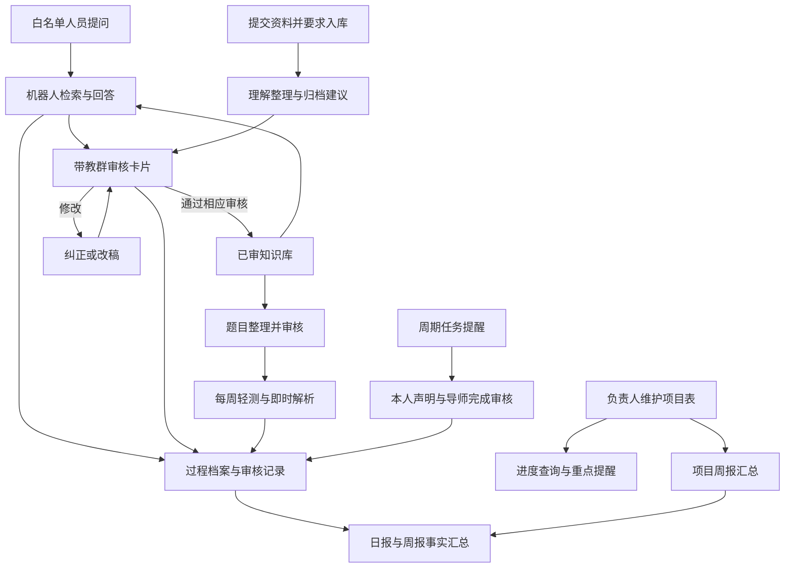

# 管培生带教 AI 协同｜业务共识 v1.0

日期：2026-09-08。

**状态：Q1—Q19 对应的业务选择已完成，本稿待常浩整体确认。本文汇总已明确的目标、分工、六类流程及其衔接；验收核对点为根据这些选择整理的待确认表述。本文不是实施规格，也不代表系统已经搭建或自动化已经开启。**

## 一、目标与定位

培养目标是：**管培生能够独立理解业务问题、形成判断并推进小项目。**

带教机器人承担知识支持、提醒和完成确认，通过答疑与知识沉淀、项目进度信息、轻量理解测试和周期任务跟进，为带教提供持续支持。培养目标由实际工作与导师带教共同实现，不能仅凭机器人回复数、问答入库量或选择题正确率证明能力提升。

Q2①确定的介入范围持续有效。全过程业务方案指导、替管培生作业务决策、专业成果评阅，均不作为已确认的机器人职能。项目推进是核心板块，其明确结果是准确生成周报、随时查询表内进度、提醒重点事项及做必要跟进。

## 二、底座怎样串联

知识库为答疑和小测提供依据；机器人承接入口和交互；工作流串联审核、纠正、入库、定时汇总及提醒；多维表格承载过程记录，并提供由人维护的项目进度事实。

图中“修改后回审”适用于机器人依据修改意见重新生成的内容；常浩已给出可直接使用的最终答案时，按第三节直接落实。知识入库仍须具备对应位置及拟写内容的确认。

这里的多维表格有两类业务职责：**协作过程记录由机器人按流程沉淀；指定项目推进表由各项目负责人维护，机器人只读。** 具体使用几张表、怎样关联及字段名称，属于实施设计，尚未确定。

## 三、答疑：每一次问答都有审核、有纠正、有沉淀

适用范围为白名单人员与机器人发生的问答，入口包括群聊、与机器人的私聊、授权文档评论等。业务目标是多入口统一处理；具体入口的事件接收、权限和回传能力需要实施核验。“白名单”不意味着机器人能够读取该人员的所有私聊或所有文档。

基本链路：**提问 → 检索依据并回答 → 送带教群审核 → 通过或纠正 → 确认归档及知识整理内容 → 入库留档。**

1. 机器人保留问题、必要上下文、答复与依据，向提问人作答，同时把本次问答送审。
2. 带教群卡片显示精简问题、答案和依据摘要，并附完整记录链接；完整档案保存答复版本、审核意见与纠正过程。
3. 本次答复仍待审时，有明确有效的已审知识依据且不涉及新增判断的内容，可用于日常执行；推断、依据不足或冲突部分，要等常浩确认。
4. 答案被否决时，原入口收到相关结论已被否决、正在纠正的提示。常浩给出完整最终答案，机器人直接落实；只给出错因或原则，机器人改稿后再审。
5. 最终纠正回到原提问入口，明确替代的旧答复；带教群同步精简处理结果。
6. 所有审核通过的问答完整归档入库，同时在多维表格保留流程记录。有通用价值的内容另提炼为可复用知识，呈现拟放位置及拟新增、修改的内容，由常浩确认后写入。

答复正确性的确认与归档位置、知识整理内容的确认可以在同一张卡片中完成；某部分尚未确认时，不能因为另一部分已通过就视为全部获准。常浩提供最终答案免去的是对同一答案的重复审核，未确认的知识整理和位置仍遵守入库规则。

完整档案中的历史待审或被否决版本用于追溯，不能混入有效答案。一次性项目进度可按时间留在问答档案中，有可复用规则时再提炼，避免把一次状态描述写成长期知识。

## 四、知识资产：机器人整理，导师确定内容与位置

常浩把文档或其他资料发给机器人并要求整理入库后，机器人理解资料内容与现有知识库框架，提出补充已有文档、新建条目或节点的建议。

基本链路：**提交资料 → 读取理解 → 检查现有内容与冲突 → 提出位置和拟写内容 → 审核确认 → 写入并保留来源。**

审核应让常浩看清“资料讲什么、放在哪里、补充或新建什么、是否影响原内容”。没有冲突时，按拟定位置和内容审核；存在冲突时，整理新旧表述及来源，整份暂缓入库，处理清楚并审核后再统一入库。不能以“资料更新”自动推定新结论正确，也不先发布其中的无争议部分。

知识库通过资料与已审问答共同扩充。机器人可以提出结构调整建议，实际新增、填入或修改内容都受已确认范围约束。资料无法读取时，要明确说明缺少的内容，不能声称已理解或已完成入库。

## 五、项目支持：围绕实际项目表提供信息与提醒

各项目的管培生负责人维护项目推进表，常浩监督。机器人读取指定表，承担三项明确结果：

| 结果 | 已确认的行为 | 数据边界 |
|---|---|---|
| 周报准确 | 从指定项目表整理项目进展，关联记录供核对 | 不额外要求每人每周再填一份进度报告 |
| 进度可问 | 用户询问时，准确转述表内当前记录，说明来源及可取得的更新信息 | 不能把读取表视为独立核验，更不能自行补出进度 |
| 重点可提醒 | 对约定重点事项做提醒及必要跟进，提示负责人维护表 | 具体字段、触发条件及提醒内容在实施时依实际表确认 |

项目与关键节点按表内实际信息使用，不要求预先增加细任务层级。机器人不自动回写项目表；聊天说明与审核记录不能替换表里的正式项目状态。发现记录不一致时列为待核对，提示负责人处理。

“没有更新”表示缺少最新信息，不直接等于没有推进或已经延期。某项任务审核通过，也不自动意味着整个项目完成，或项目表已经更新。

项目进度自由查询是白名单问答规则的适用场景，回答同样送审；它准确转述表内记录，不把表中信息包装成已经经过导师确认的新增判断。定时项目周报则按第六节独立汇总发布。

## 六、日报周报：让事实和待处理事项及时可见

日报重点呈现问答、知识入库及相关任务等单点内容；周报汇总相应记录，并增加指定项目表中的进度。

**两类报告按约定时间和接收范围自动发布事实汇总，不逐次增加发布审批。** 报告保留来源，区分已通过、待审核、待补充等状态；待审内容不会因为被写进日报或周报就变为已审知识。发现汇总错误时，常浩可以要求纠正。

项目汇总以指定表为依据，缺少更新和已发现的不一致如实列明。具体栏目与表中字段、报告接收人、群、时间在实施配置时统一确定；个人测验记录的可见范围另行明确。

## 七、轻测试：少量理解检查与正常温习

围绕方法论、思维模型等结构化知识出选择题，依据已审知识与已确认问答。**每周一次，每次 2—3 道。** 当前梳理机制，不生成实际测验题。

基本链路：**整理新题与标准解析 → 集中审核 → 按节奏抽取 → 选择作答 → 即时解释 → 记录 → 后续正常温习。**

- 新题先呈现题目、标准答案、简短解释及知识出处，集中审核一次；通过后可以按节奏复用。
- 题目改动或依据知识变化时，相关题重新审核后再使用。
- 作答后即时返回已审正确选项、简短解析和知识出处；标准解析无需每次重新审核。
- 答错的知识点可以在后续正常小测中再次抽取，总量仍为每次 2—3 道，不加额外补考。
- 没有作答只记为“未答”，不判成答错、不推断为没有理解、不追加催答。

不增加简答、重型案例任务或排名机制。学员在解析后继续提出自由问题时，沿用普通问答流程。测试记录用于观察知识点理解，不能单独认定独立处理业务或推进项目的能力。

## 八、周期任务：提醒、本人声明、导师确认

月度营销物料上传是已明确的首个周期任务。以每个自然月最后一天为基准：

| 时点或事件 | 机器人行为 | 状态含义 |
|---|---|---|
| 月末提前三天 | 提醒完成本月任务 | 进入提醒阶段 |
| 月末前一天 | 只补提醒尚未声明完成者 | 避免已提交者反复收到催交 |
| 管培生声明完成 | 收集声明，允许附说明，不强制文件或链接 | 已声明，待导师确认；暂停催交 |
| 月末最后一天 | 向常浩发送审核卡片，展示真实状态 | 不把声明直接当成完成通过 |
| 常浩通过 | 记录完成审核结果 | 该项提交审核通过 |
| 常浩退回 | 通知补做并保留退回意见 | 尚未通过，等待补做与确认 |

例如 30 日为月末，提前三天是 27 日，前一天是 29 日，最后一天是 30 日。具体发送时刻、接收位置及退回后的时间要求留到配置时明确。其他定时任务可复用这一流程，逐项确认任务和周期，不能由机器人自行推定新任务。

完成声明、导师审核结果、项目表状态分别记录。有关联时，机器人提示对应负责人维护项目表，仍不自动回写。

## 九、共同规则与异常边界

| 事项 | 一致规则 |
|---|---|
| 人的责任 | 常浩审核答案、知识内容与位置、题目以及周期任务完成；项目负责人维护自己的项目记录 |
| 机器人的责任 | 承接输入、检索整理、送审纠正、经审入库、事实汇总、轻测反馈、提醒与必要跟进 |
| 待审状态 | 未收到确认就保持待审，不因时间经过自动通过 |
| 来源不充分 | 说明缺少依据、权限或更新情况，不补造事实或声称处理成功 |
| 知识冲突 | 争议回答待确认；冲突资料整份处理清楚后统一审核入库 |
| 数据不一致 | 区分本人报告、审核结果和指定表内事实，列明待核对项 |
| 操作失败 | 实施时应保留真实结果并提示失败，不把“审核通过”冒充“已实际入库”或“已送达” |

最后一项是从已确认业务结果推导的实现可靠性要求，具体失败提示、重试与补偿由实施设计解决，不新增常浩的日常决策负担。业务规则不会赋予应用超出实际授权的读取能力。

## 十、怎样判断实现符合本次共识

以下是根据已选规则整理的验收核对点，随本稿整体核对；当前尚未完成实现验证。

1. 白名单人员从每个已接入入口提问后，机器人答复和审核群记录能够对应；否决提示与最终纠正能回到原入口。
2. 审核通过的问答有完整档案和多维表格流程记录；可复用知识仅在位置与拟写内容确认后写入，错误历史版本不作为有效答案。
3. 资料整理能呈现位置和拟写内容；包含冲突的资料在全部处理清楚并审核前不发布其中任何部分。
4. 同一项目的进度查询与周报能追溯到指定表；机器人不修改项目表，缺更新或不一致如实说明，约定重点提醒按实际字段触发。
5. 日报周报能够按约定自动发布，待审与已审状态清楚，原始记录能够核对。
6. 轻测符合每周一次、每次 2—3 道及先审题后使用；答后有标准解析，错题温习不增加题量，未答不催答。
7. 周期任务按已选节奏提醒；声明后暂停催交，月底发审核卡片，最终状态取决于导师确认。

这些核对点检验协同系统是否履行职能。管培生能力成长仍需结合实际工作表现与导师观察，不以系统活动量代替。

## 十一、留到实施时确认的事项

| 事项 | 需要落实的内容 |
|---|---|
| 对象与范围 | 白名单、审核群、知识库空间及节点、项目表、资料入口与报告接收范围 |
| 实际表结构 | 项目表已有字段、可查询信息、周报栏目、重点事项及提醒条件；不提前强制字段或层级 |
| 发送配置 | 日报、周报、月度任务、轻测的具体时间和位置，退回补做后的时间要求 |
| 卡片呈现 | 摘要与完整记录入口、审核与修改方式、位置及拟写内容的清晰展示 |
| 可见范围 | 各类记录和来源链接的访问范围，个人测验记录的接收对象 |
| 能力验证 | 各入口事件与回传、卡片回调、文档和知识库写入、定时执行、失败处理与重复执行可靠性 |
| 实施路线 | 选用现有配置还是必要开发、可否复用历史工程、依赖成本与上线顺序，由实际能力核验决定 |

以上是落实配置及验证工作，不表示要再展开一轮抽象项目管理访谈。涉及成本、访问范围或结果取舍的变化再明确给常浩；技术实现问题由执行方解决。

## 十二、确认对象与下一步

本次确认对象是**本文 v1.0 的业务理解、六类流程、边界与验收核对点**。单题选择均已记录，当前仅待整体核对，避免把多轮回答组合成偏离原意的系统。

确认一致后，再进入实施规格和资源能力核验，把第十一节配置项落实到实际飞书资源。默认机器人为机械邪龙兽，使用 codex profile，App ID 为 cli_aacf58ab61b85beb；不改用其他机器人。

本轮没有读取真实私人聊天、创建项目表、写入业务知识库、发送业务消息或启动定时任务。

原始选择依据保存在同目录：`Grill-本轮问题清单.md`、`Grill-下一轮问题清单-Q8-Q12.md`、`Grill-项目推进与轻测试-Q13-Q17.md`、`Grill-发布与反馈-Q18-Q19.md`。Q1 培养目标与 Q2 介入范围同时保留在交接和这些历史记录中。
